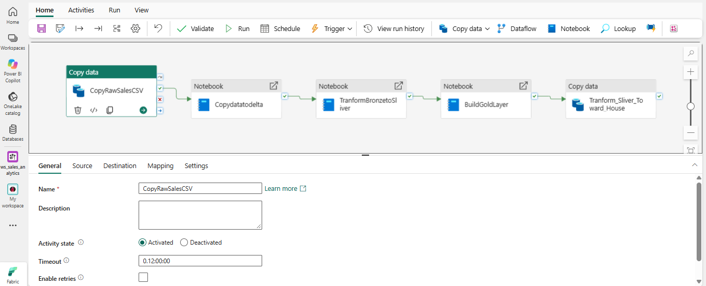
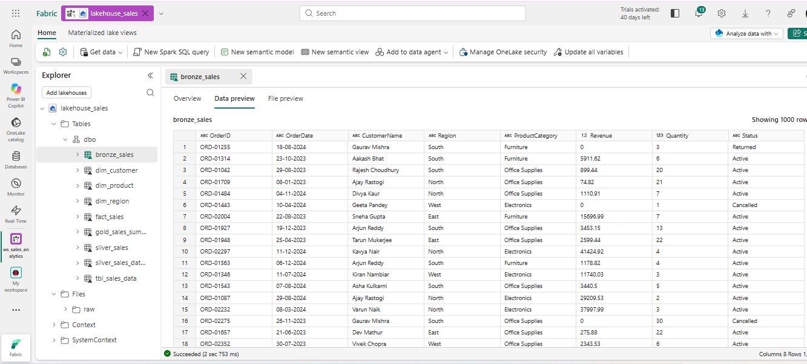
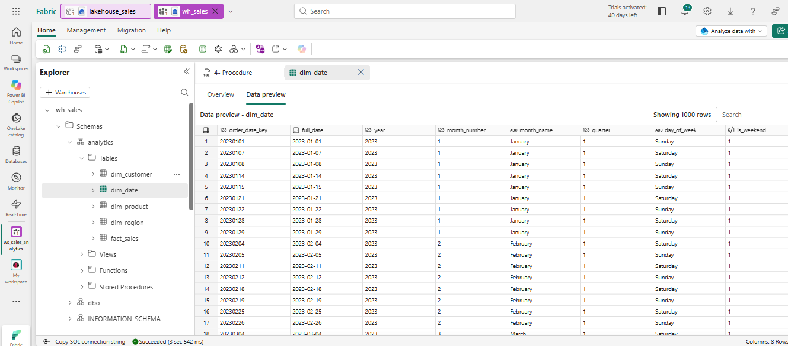

# End-to-End Sales Analytics & Data Warehouse Pipeline (Microsoft Fabric)

## Project Overview
An end-to-end data engineering and business intelligence solution built in **Microsoft Fabric**. This project ingests raw sales CSV data, transforms it across a **Medallion Architecture (Bronze → Silver → Gold)** inside a Fabric Lakehouse, models a **Star Schema** in a Fabric Data Warehouse, and delivers an interactive **Power BI** executive dashboard.

---

## Architecture & Orchestration
The entire ETL workflow is orchestrated automatically using a **Microsoft Fabric Data Pipeline** that links ingestion, PySpark transformation notebooks, staging copies, and T-SQL stored procedures.



### Workflow Stages
1. **Ingestion (`nb_load_to_delta.ipynb`)**: Loads raw CSV sales files into the Bronze layer as Delta tables.
2. **Data Cleaning (`nb_transform_bronze_to_sliver.ipynb`)**: Standardizes date formats (`dd-MM-yyyy`), removes duplicates, and converts revenue from INR to USD.
3. **Aggregation (`nb_build_gold_layer.ipynb`)**: Builds summarized monthly and regional KPIs (`gold_sales_summary`) for high-level reporting.
4. **Dimensional Modeling (`nb_build_tables.ipynb`)**: Generates surrogate keys and builds Star Schema tables (`fact_sales`, `dim_customer`, `dim_product`, `dim_region`).
5. **Warehouse Consolidation (`Warehouse_SQL_Scripts.sql`)**: Creates and populates `dim_date` and uses T-SQL cross-database queries to consolidate the Star Schema into the Data Warehouse (`wh_sales`).

---

## Lakehouse & Data Warehouse
* **Lakehouse**: Stores Bronze, Silver, Gold, and Star Schema Delta tables managed via PySpark.
* **Data Warehouse (`wh_sales`)**: Houses the `staging` and `analytics` schemas optimized for SQL querying and Power BI Direct Lake reporting.

| Lakehouse Tables | Data Warehouse (`wh_sales`) |
| :---: | :---: |
|  |  |

---

## Star Schema Data Model
The Power BI Semantic Model connects **`fact_sales`** to four dimension tables (`dim_date`, `dim_customer`, `dim_product`, `dim_region`) using one-to-many relationships on integer surrogate keys.


### Key DAX Measures
* **Total Revenue & Total Revenue USD**: Dynamic sum of sales across regions, categories, and months.
* **Total Orders & Total Quantity Sold**: Order volume and unit count tracking.
* **Average Order Value (AOV)** & **Avg Revenue per Customer**: Ratio metrics calculated via `DIVIDE()`.
* **Customer Rank**: Dynamic ranking using `RANKX()` to identify top-performing customers.

---

## Power BI Dashboard
📄 **[View the Full Power BI Report (PDF)](Sales%20Report%20Power%20BI.pdf)**

The executive dashboard tracks:
* **KPI Cards**: Total Revenue, Total Orders, Total Quantity Sold, Total Customers, and Average Order Value.
* **Trend Analysis**: Monthly revenue and order volume trends sorted chronologically via `dim_date`.
* **Regional & Category Breakdown**: Performance comparison across North, South, East, and West regions.
* **Customer Leaderboard**: Top 10 customers ranked by total revenue.

---

## Repository Structure
```text
├── Images/
│   ├── Lakehouse.png
│   ├── Pipeline.png
│   ├── Semantic Model.png
│   └── Wareshouse.png
├── Notebooks/
│   ├── nb_load_to_delta.ipynb
│   ├── nb_transform_bronze_to_sliver.ipynb
│   ├── nb_build_gold_layer.ipynb
│   └── nb_build_tables.ipynb
├── Sales Report Power BI.pdf
├── Warehouse_SQL_Scripts.sql
└── README.md
```
